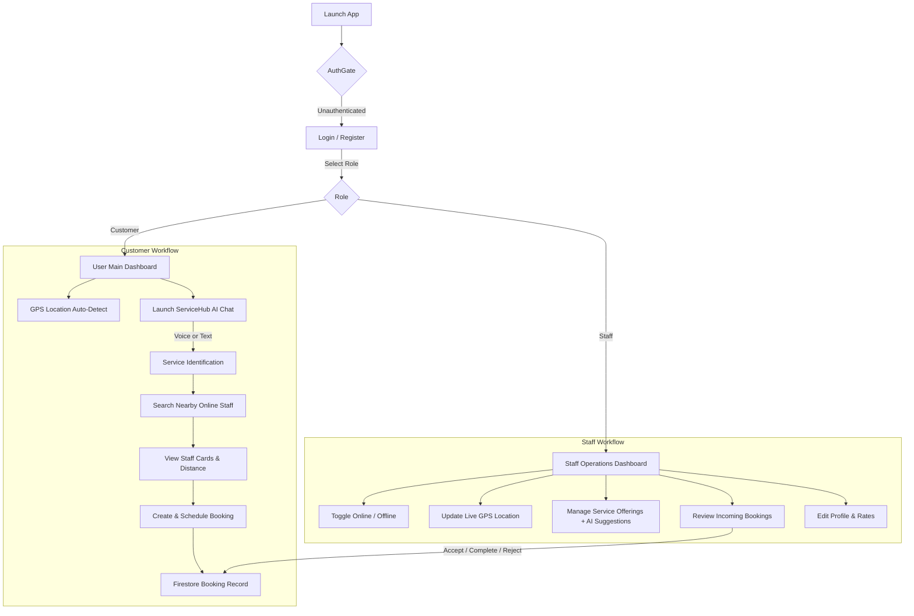

<div align="center">

# 🔧 ServiceHub AI

### *AI-Powered On-Demand Service Booking Platform*

<br/>

[](https://flutter.dev)
[](https://dart.dev)
[](https://firebase.google.com)
[](https://groq.com)
[](https://bloclibrary.dev)
[](LICENSE)

<br/>

> **ServiceHub AI** is an intelligent, full-stack service booking application that eliminates manual category browsing. Users describe their household or technical problems in plain English (via **text** or **speech-to-text voice input**), and an LLM-driven intelligence engine identifies the required service, queries real-time geolocation data, and matches users with available nearby professionals.

<br/>

---

</div>

## 📑 Table of Contents

- [✨ Core Capabilities](#-core-capabilities)
- [📱 User & Staff Workflows](#-user--staff-workflows)
- [🖥️ UI & Design System](#️-ui--design-system)
- [🏗️ Clean Architecture](#️-clean-architecture)
- [🧠 AI & Backend Integration](#-ai--backend-integration)
- [⚙️ Tech Stack](#️-tech-stack)
- [📁 Project Structure](#-project-structure)
- [🚀 Getting Started](#-getting-started)
- [🗺️ Roadmap](#️-roadmap)
- [📄 License](#-license)

---

## ✨ Core Capabilities

### 🎙️ Multimodal AI Assistant (Text & Voice)
- **Natural Language Parsing**: Users speak or type their problem (e.g., *"Water is leaking under my kitchen sink and spraying onto the cabinet"*).
- **Voice-to-Text**: Built-in speech recognition powered by `speech_to_text` with an interactive, animated microphone interface.
- **Service Classification**: Translates unstructured customer descriptions into exact service domains (e.g., Plumbing, Electrical, Carpentry).
- **Service Request Fallback**: If a requested service is not currently offered, users can submit an on-demand service request directly from the chat conversation.

### 📍 Geospatial Staff Matching
- **Live GPS Detection**: Integrates `geolocator` and `geocoding` to automatically detect and display the customer's current address.
- **Radius-Aware Staff Search**: Discovers nearby service professionals based on real-time coordinates, service specialty, and online availability.
- **Interactive Staff Cards**: View staff profiles, verified distance in kilometers, service badges, and avatar directly within the chat stream.

### 👨‍🔧 Comprehensive Staff Operations Center
- **Availability Toggle**: Real-time Online/Offline status switch with live Firestore synchronization.
- **Live Location Sync**: Continuous GPS location updates so customers can find active nearby staff.
- **Service Catalog Management**: Add custom service offerings with AI-assisted title suggestions and pricing.
- **Booking Management**: Accept, reject, or mark bookings as completed with instant status updates.
- **Profile Customization**: Manage hourly rates, contact numbers, skills, experience, and profile avatars.

### 📅 End-to-End Booking Management
- **Flexible Scheduling**: Book immediate assistance or schedule appointments for future dates and times.
- **Customer Profiles & Notes**: Automatic customer address pre-fill and optional service instructions.
- **Real-Time Booking Status**: Full booking lifecycle tracking (`pending`, `confirmed`, `completed`, `cancelled`) across both customer and staff portals.

### 🔔 Push Notifications
- **Firebase Cloud Messaging (FCM)**: Automatically registers staff device tokens upon login to deliver immediate job notifications.

---

## 📱 User & Staff Workflows



---

## 🖥️ UI & Design System

The application is built on a **Dark Neo-Neumorphic & Glassmorphism** design language:

- **Surface Palette**: Deep charcoal background (`#161618`) paired with card surfaces (`#1E1E20`).
- **Signature Accent**: Electric hot pink neon (`#E92E5F`) for active states, primary actions, and focus rings.
- **Custom Canvas Dial**: Custom-painted circular dial meter (`StaffAnimatedBackground` & `AnimatedBackground`) featuring sweeping glow ticks.
- **Frosted Glassmorphism**: Translucent cards with `ImageFilter.blur`, light specular borders, and subtle elevation shadows.
- **Floating Pill Navigation Bar**: Blur-backed floating navigation bar with fluid size transitions.

### Color Tokens ([`lib/core/theme/app_colors.dart`](lib/core/theme/app_colors.dart))

| Token | Hex Value | Usage |
|---|---|---|
| `background` | `#161618` | Scaffold base background |
| `surface` | `#1E1E20` | Cards, sheets, dialog surfaces |
| `primary` | `#E92E5F` | Main brand neon accent, CTA buttons |
| `textLight` | `#F5F5F5` | High-contrast primary headings & text |
| `textLightSecondary` | `#A0A0A8` | Subtitles, timestamps, placeholders |
| `borderLight` | `#2E2E32` | Glass card borders & subtle dividers |

---

## 🏗️ Clean Architecture

The codebase strictly adheres to **Clean Architecture** principles and feature-driven organization:

```
lib/
├── core/
│   ├── config/              # Centralized API and environment configuration
│   ├── notification/        # Firebase Cloud Messaging initialization & token management
│   ├── service/             # GetIt dependency injection registry
│   ├── theme/               # Global design tokens and color constants
│   └── widgets/             # Reusable design components (animated dial background, etc.)
│
├── features/
│   ├── ai/                  # AI Chat, voice input, service identification & staff search
│   ├── auth/                # Authentication, session guarding, login & register
│   ├── booking/             # Booking creation, status transitions & staff requests
│   ├── location/            # GPS position tracking, geocoding & permission handling
│   ├── staff/               # Staff home, availability, profile editing & service catalog
│   └── user/                # Customer dashboard, activity feed & profile management
│
├── firebase_options.dart    # Generated Firebase platform configurations
└── main.dart                # App entrypoint and top-level providers
```

### Architectural Layering

```
Presentation Layer (Widgets, Pages, BLoCs)
           │  dispatches events / renders state
           ▼
Domain Layer (Entities, Use Cases, Repository Contracts)
           │  pure Dart business logic
           ▼
Data Layer (Models, Repositories Implementation, Remote/Local Datasources)
           │  network calls, Firestore queries, external SDKs
           ▼
External Infrastructure (FastAPI Backend, Firebase Auth, Cloud Firestore, Device GPS)
```

---

## 🧠 AI & Backend Integration

ServiceHub AI uses a hybrid architecture that balances generative language understanding with authoritative database records:

> 🛡️ **Rule of Integrity:** Groq LLM handles natural language interpretation, speech-to-text clarification, and structured query classification. It **never** fabricates staff members, availability, or distances. All provider data and bookings reside securely in **Cloud Firestore**.

### REST API Endpoints ([`ApiConfig`](lib/core/config/api_config.dart))

| Endpoint | Method | Purpose |
|---|---|---|
| `/identify-service` | `POST` | Translates user prompt into a recognized service category and response message |
| `/service-requests` | `POST` | Logs user requests for unlisted or new service types |
| `/staff/search` | `GET` | Queries nearby available staff by latitude, longitude, service name, and radius |
| `/staff/service-suggestions` | `POST` | Generates AI-recommended service names for staff profile setup |

---

## ⚙️ Tech Stack

| Layer | Package / Tool | Purpose |
|---|---|---|
| **Language & SDK** | Flutter 3.x / Dart 3.x | Cross-platform mobile foundation |
| **State Management** | `flutter_bloc` (^9.1.1) + `equatable` | Predictable, reactive state management |
| **Dependency Injection** | `get_it` (^9.2.1) | Decoupled service locator |
| **Networking** | `dio` (^5.11.1) | Robust HTTP client with interceptors & timeouts |
| **Authentication** | `firebase_auth` & `google_sign_in` | Email/password & Google SSO authentication |
| **Cloud Database** | `cloud_firestore` (^6.10.0) | Real-time database for users, staff, services & bookings |
| **Push Notifications** | `firebase_messaging` (^16.7.0) | Background & foreground staff job alerts |
| **Location Services** | `geolocator` (^14.0.3) & `geocoding` (^5.0.0) | Device coordinates & reverse geocoding to human addresses |
| **Voice Recognition** | `speech_to_text` (^7.5.0) | Direct voice input for the AI assistant |
| **Navigation** | `go_router` / Flutter Navigator | Declarative and modal routing |
| **AI Engine** | FastAPI Backend + Groq API | Conversational LLaMA-based service assistant |

---

## 📁 Project Structure

<details>
<summary><b>Click to expand full file tree</b></summary>

```
lib/
├── core/
│   ├── config/
│   │   └── api_config.dart
│   ├── notification/
│   │   └── notification_service.dart
│   ├── service/
│   │   └── service_locator.dart
│   ├── theme/
│   │   └── app_colors.dart
│   └── widgets/
│       └── staff_animated_background.dart
│
├── features/
│   ├── ai/
│   │   ├── data/
│   │   │   ├── datasources/ai_remote_datasource.dart
│   │   │   └── repositories/ai_repository_impl.dart
│   │   ├── domain/
│   │   │   ├── repositories/ai_repository.dart
│   │   │   └── usecases/
│   │   │       ├── identify_service.dart
│   │   │       ├── search_nearby_staff.dart
│   │   │       └── submit_service_request.dart
│   │   └── presentation/
│   │       ├── bloc/
│   │       │   ├── ai_bloc.dart
│   │       │   ├── ai_event.dart
│   │       │   └── ai_state.dart
│   │       ├── models/chat_message.dart
│   │       ├── pages/ai_chat_page.dart
│   │       └── widgets/
│   │           ├── chat_bubble.dart
│   │           ├── chat_input_bar.dart
│   │           ├── staff_result_card.dart
│   │           ├── staff_results_list.dart
│   │           └── suggested_service_card.dart
│   │
│   ├── auth/
│   │   ├── data/
│   │   │   ├── datasources/auth_datasource.dart
│   │   │   ├── models/app_user_model.dart
│   │   │   └── repositories/auth_repository_impl.dart
│   │   ├── domain/
│   │   │   ├── entities/app_user.dart
│   │   │   ├── repositories/auth_repository.dart
│   │   │   └── usecases/
│   │   │       ├── get_current_user.dart
│   │   │       ├── google_login.dart
│   │   │       ├── login_user.dart
│   │   │       ├── logout_user.dart
│   │   │       └── register_user.dart
│   │   └── presentation/
│   │       ├── bloc/
│   │       ├── pages/
│   │       │   ├── auth_gate.dart
│   │       │   ├── login_page.dart
│   │       │   └── register_page.dart
│   │       └── widgets/
│   │           ├── animated_background.dart
│   │           └── role_chip.dart
│   │
│   ├── booking/
│   │   ├── data/
│   │   │   ├── datasources/booking_datasource.dart
│   │   │   ├── models/booking_model.dart
│   │   │   └── repositories/booking_repository_impl.dart
│   │   ├── domain/
│   │   │   ├── entities/booking.dart
│   │   │   ├── repositories/booking_repository.dart
│   │   │   └── usecases/
│   │   │       ├── create_booking.dart
│   │   │       ├── get_staff_bookings.dart
│   │   │       └── update_booking_status.dart
│   │   └── presentation/
│   │       ├── bloc/
│   │       │   ├── booking_bloc.dart
│   │       │   └── customer_booking_bloc.dart
│   │       ├── pages/create_booking_page.dart
│   │       └── widgets/
│   │           ├── staff_booking_card.dart
│   │           └── staff_booking_requests_sliver.dart
│   │
│   ├── location/
│   │   ├── data/
│   │   │   ├── location_service.dart
│   │   │   └── repositories/location_repository_impl.dart
│   │   ├── domain/
│   │   │   ├── repositories/location_repository.dart
│   │   │   └── usecases/
│   │   │       ├── get_current_location.dart
│   │   │       ├── get_location_name.dart
│   │   │       └── get_location_stream.dart
│   │   └── presentation/location_permission_page.dart
│   │
│   ├── staff/
│   │   ├── data/
│   │   │   ├── datasources/
│   │   │   │   ├── staff_profile_datasource.dart
│   │   │   │   └── staff_service_datasource.dart
│   │   │   ├── models/
│   │   │   │   ├── staff_profile_model.dart
│   │   │   │   └── staff_service_model.dart
│   │   │   └── repositories/
│   │   ├── domain/
│   │   │   ├── entities/
│   │   │   │   ├── staff_profile.dart
│   │   │   │   └── staff_service.dart
│   │   │   ├── repositories/
│   │   │   └── usecases/
│   │   └── presentation/
│   │       ├── bloc/
│   │       │   ├── staff_profile_bloc.dart
│   │       │   └── staff_service_bloc.dart
│   │       ├── pages/
│   │       │   ├── edit_staff_profile_page.dart
│   │       │   ├── staff_home_page.dart
│   │       │   ├── staff_main_page.dart
│   │       │   └── staff_profile_page.dart
│   │       └── widgets/
│   │           ├── add_staff_service_dialog.dart
│   │           ├── service_suggestion_tile.dart
│   │           ├── staff_glow_fab.dart
│   │           ├── staff_service_card.dart
│   │           ├── staff_services_sliver.dart
│   │           ├── staff_stat_card.dart
│   │           └── staff_status_pill.dart
│   │
│   └── user/
│       ├── data/
│       ├── domain/
│       └── presentation/
│           ├── bloc/user_profile_bloc.dart
│           └── pages/
│               ├── user_home_page.dart
│               └── user_main_page.dart
│
├── firebase_options.dart
└── main.dart
```

</details>

---

## 🚀 Getting Started

### Prerequisites

- [Flutter SDK](https://flutter.dev/docs/get-started/install) (`^3.13.2` or later)
- [Dart SDK](https://dart.dev/get-dart) (`^3.x`)
- [Firebase CLI](https://firebase.google.com/docs/cli)
- An active Firebase Project (with Authentication & Cloud Firestore enabled)
- A running ServiceHub FastAPI backend instance (or compatible endpoint)

### Installation

1. **Clone the repository:**
   ```bash
   git clone https://github.com/YOUR_USERNAME/service_hub_ai.git
   cd service_hub_ai
   ```

2. **Install Flutter packages:**
   ```bash
   flutter pub get
   ```

3. **Configure Firebase:**
   Generate the platform options file using the FlutterFire CLI:
   ```bash
   flutterfire configure
   ```

4. **Run the App:**
   By default, the API base URL points to `http://192.168.220.45:8000`. You can override it during launch:
   ```bash
   flutter run --dart-define=API_BASE_URL=http://<YOUR_BACKEND_IP>:8000
   ```

---

## 🗺️ Roadmap

- [ ] **Live Route Tracking**: Google Maps Polyline tracking showing staff traveling to the customer location in real time.
- [ ] **In-App Messaging**: Real-time Firestore chat between the customer and assigned staff member.
- [ ] **Reviews & Ratings**: Post-completion star ratings and written reviews reflected on staff profiles.
- [ ] **Payment Integration**: Secure escrow/card payment integration upon service completion.
- [ ] **Staff Earnings Analytics**: Detailed weekly and monthly revenue breakdown charts.

---

## 📄 License

This project is licensed under the MIT License — see the [LICENSE](LICENSE) file for details.

<br/>

<div align="center">

**Built with ❤️ using Flutter, Firebase & Groq AI**

*ServiceHub AI — Connecting people with trusted service professionals, powered by AI.*

</div>
